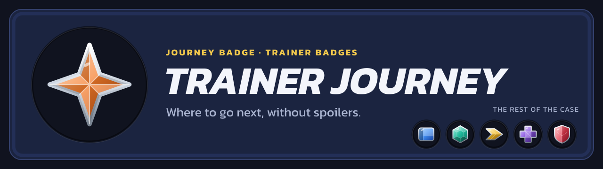
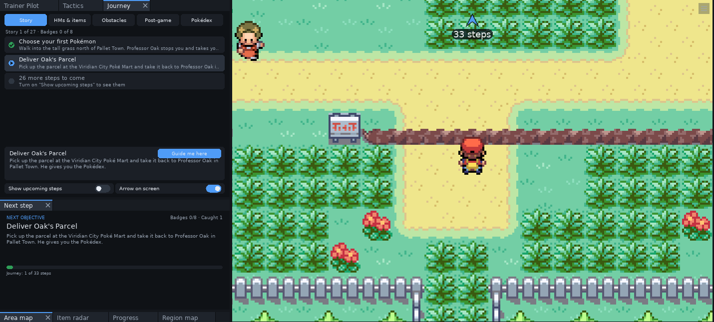
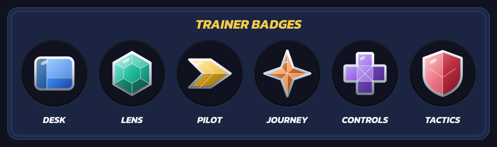

# Trainer Journey

A journey guide for Pokémon FireRed/LeafGreen on Gen1Recomp (mod API 3). It reads your save (event flags, badges, bag, Pokédex and party) and tells you what to do next. Nothing in the game is changed.



## What it does

- **Next step panel:** the current objective with where to go and how, your badges and kinds caught, how far along the journey you are, and what you can do on the way: Pokédex gifts waiting for you, items you can pick up now, HMs nobody in the party knows yet, side trips.
- **Journey panel**, with five lists:
  - **Story:** 28 steps from choosing your first Pokémon to the Champion, plus the optional Sevii Islands trip.
  - **HMs & items:** where to get every HM and key item, from when, and whether each HM works outside battle with your badges.
  - **Obstacles:** what blocks the way (small trees, water, boulders, Snorlax, the Saffron gates, the badge gates...) and what you still need for each, including a Pokémon that knows the move.
  - **Post-game:** National Pokédex, Celio's network (Ruby and Sapphire), Mewtwo, and the three legendary birds.
  - **Pokédex:** the gifts from Professor Oak's aides for 10 to 50 kinds caught, and the National Pokédex at 60.
- **Arrow on the game screen:** points the way to the current objective, at the border of the game picture, with the number of steps. It follows the real links between maps (edges, doors, caves, stairs, and the Seagallop ferry once you hold the passes), so it points at the next door or edge to take, and at the person to talk to once you are on the objective's map. It hides during battles, menus and messages. Turn it off with the **Arrow on screen** switch or the **Arrow to the objective** option.
- **Your own goal:** pick any HM, key item, Pokédex gift or side trip in the Journey panel and press **Guide me here**; the arrow and the Next step panel follow it until you have it.
- **No spoilers by default:** steps you have not reached yet show as a count ("5 more steps to come"). The **Show upcoming steps** switch in the Journey panel names them all; the choice is remembered.

## Compatibility

| | |
| --- | --- |
| Games | FireRed and LeafGreen |
| Gen1Recomp | 0.3.93 or newer (mod API 3); tested on 0.4.8 |

## Installation

Copy the `trainer_journey` folder into the game's mods folder:

```
%APPDATA%\pokemon-love2d\mods\trainer_journey
```

Its panels appear in the Trainer Desk docks, so Trainer Desk is needed to see them. Trainer Journey does not need Trainer Lens or Trainer Pilot.

## Options

| Option | Default | What it does |
| --- | --- | --- |
| Language | English | Language of the panels: ENGLISH, ESPANOL, PORTUGUES or JAPANESE. |
| Arrow to the objective | On | The arrow on the game screen. The Journey panel's switch changes it too; changing the option again sets it back to the option. |

## Languages

The panels are in English, Spanish, Portuguese and Japanese. Place and item names follow each language's version of the games (Portuguese keeps the English names, as the games were never released in Portuguese). Japanese text is drawn with a cut-down copy of Noto Sans JP in `trainer_journey/fonts/` (SIL Open Font License). See [docs/TRANSLATING.md](docs/TRANSLATING.md).

## Documentation

- [docs/GUIDE.md](docs/GUIDE.md): player guide.
- [docs/ARCHITECTURE.md](docs/ARCHITECTURE.md): how the mod is organised and how a step is decided.
- [docs/TRANSLATING.md](docs/TRANSLATING.md): translations.
- [docs/PUBLISHING.md](docs/PUBLISHING.md): releases and the Gen1Recomp mod index.
- [CHANGELOG.md](CHANGELOG.md): version history.

## Known limits

- A few steps have no flag of their own and are judged by what follows them or by a key item in the bag (for example, the Rocket Hideout is done once you hold the Silph Scope).
- Story steps are listed in the usual order; doing things in another order is fine, and the next step is always the first one not done.
- The arrow plans by the links between maps, not by the tiles: it knows which door or edge leads on, but not obstacles inside a map (a ledge, a tree to cut, a puzzle). Some objectives (the Safari Zone area with the Gold Teeth, Silph Co. floors, the Pokémon Mansion) point to the map, not to the exact spot.
- Ruby, Sapphire and Emerald are not covered.

## The Trainer Badges

Six mods for FireRed and LeafGreen that work on their own and better together. Each one is a badge in the same case.



| | Mod | What it does |
| --- | --- | --- |
|  | [Trainer Desk](https://github.com/MarcoAFSchaefer/trainer-desk) | Docks and tabs around the game. |
|  | [Trainer Lens](https://github.com/MarcoAFSchaefer/trainer-lens) | Everything the game knows, on screen. |
|  | [Trainer Pilot](https://github.com/MarcoAFSchaefer/trainer-pilot) | Trains and hunts while you are away. |
|  | **Trainer Journey** (this mod) | Where to go next, without spoilers. |
|  | [Trainer Controls](https://github.com/MarcoAFSchaefer/trainer-controls) | Every button, where you want it. |
|  | [Trainer Tactics](https://github.com/MarcoAFSchaefer/trainer-tactics) | The best play, with the numbers. |

## What it changes in the game

[DIFFERENCES.md](DIFFERENCES.md) lists everything this mod does differently from the unmodded game.

## License

MIT. The bundled font is under the SIL Open Font License (`trainer_journey/fonts/OFL.txt`).
